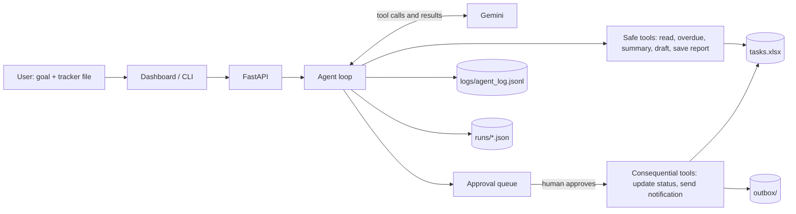

# Project Report: AI Business Workflow Automation Agent

## 1. Problem

Operations teams track work in spreadsheets and spend hours each week finding late tasks,
chasing owners and writing status reports. This project automates that loop with an LLM
agent while keeping a human in control of anything that changes data or contacts people.

## 2. Architecture

## 3. Tools

| Tool | Approval | Purpose |
|---|---|---|
| `read_tasks` | no | Filtered view of the tracker |
| `get_overdue_tasks` | no | Open tasks past deadline plus data-quality problems |
| `summarize_by_department` | no | Counts per department |
| `draft_notification` | no | Writes a reminder, never sends |
| `save_report` | no | Saves the Markdown report to `reports/` |
| `update_task_status` | **yes** | Edits the tracker (backup taken first) |
| `send_notification` | **yes** | Delivers a message (simulated: writes to `outbox/`) |

## 4. Agent loop

1. Send goal, system prompt and tool declarations to Gemini.
2. If the model returns tool calls, run each one (or queue it if it needs approval).
3. Return every result, including errors, to the model.
4. Repeat until the model answers in plain text or the 12-step limit is hit.
5. Save the run to `runs/<id>.json`; pending actions wait for approve/reject.

## 5. Safety design

- Approval gate enforced in code, not in the prompt: the model cannot run a consequential tool directly.
- Step limit stops runaway loops.
- Unknown tools and tool exceptions come back to the model as errors instead of crashing the run.
- Tracker backups before every write.
- Full audit trail in `logs/agent_log.jsonl`.
- Run ids are sanitised before reading from disk (path traversal test included).

## 6. Test results

`python -m pytest` : **26 passed**.

| Area | Cases |
|---|---|
| Data cleaning | status aliases, unknown status, missing/invalid deadlines, bad priority |
| Tool logic | overdue excludes completed/future, filters, summaries, backups, validation errors |
| Agent loop | multi-step reasoning, result feedback, error recovery, unknown tool, step limit, API failure |
| Approvals | queued not executed, approve, reject, double-decision blocked |
| Notifications | draft never sends, send only after approval, owner validation |
| Persistence/API | reload after restart, approve after reload, 404/409 responses, path traversal |

Not covered by automated tests: live Gemini responses (needs an API key). Run the three
scenarios below with a real key and keep the logs as evidence.

## 7. Demo scenarios (run with a real key)

1. *"Identify overdue tasks and prepare a weekly operations report."* Expect: overdue lookup, department summary, saved report, final summary mentioning missing deadlines.
2. *"Draft and send reminders to every owner with overdue high-priority tasks."* Expect: drafts, queued `send_notification` actions, nothing in `outbox/` until you approve.
3. *"Mark T001 as completed."* Expect: one queued action; tracker unchanged until approval.

## 8. Limitations and future work

- Notifications are simulated; connect SMTP, Slack or Teams inside `send_notification`.
- Single-user, no authentication.
- Excel/CSV only; Google Sheets API would replace `load_tasks` and `update_task_status`.
- The tracker file is read fresh on every tool call, so large files would need caching or a database.

## 9. Interview talking points

- **Agent vs automation:** the model chooses tools and order, reads results, and recovers from errors; guardrails live in code.
- **Why approval gates:** LLMs can be wrong, so irreversible actions are queued and a human decides.
- **Messy data:** status aliases and missing deadlines are handled on purpose and reported, not hidden.
- **Testing without an API:** a scripted fake model makes the agent loop deterministic and testable.
- **What I would do next:** real email delivery, Sheets integration, evaluation set for live-model behaviour, auth.

## Addendum: live Excel linking, bottleneck analysis, Excel report

- **Live Excel linking.** The dashboard polls the tracker's modified time every 3 seconds and refreshes when the file is saved. Any `.xlsx` or `.csv` can be chosen as the data source from the dashboard. Writes go to a temporary file and are swapped in, with a timestamped backup first. If Excel has the file open, the approval stays pending and can be retried.
- **Bottleneck analysis.** `analyze_bottlenecks` (workload per owner, blocked tasks, overdue by priority, delay per department, ranked attention list). Tested against hand-computed values.
- **Excel report.** `save_excel_report` produces a formatted multi-sheet workbook; figures are computed from the tracker, the model supplies only commentary.
- **Tests.** The suite now has 49 tests covering the tools, the agent loop, approvals, live source switching, locked files, bottleneck maths and the Excel output.
